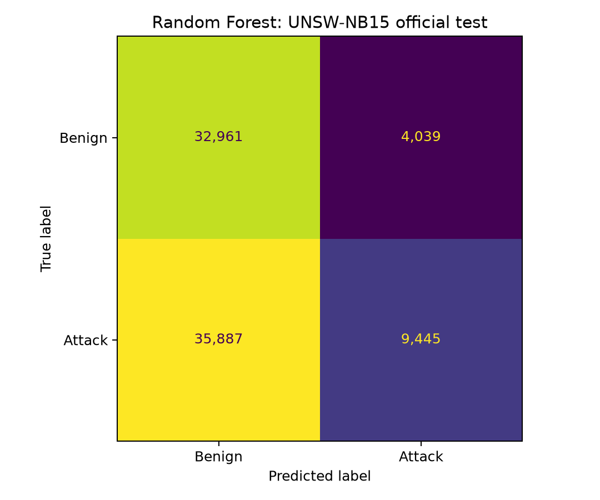

# Checkpoint results and finish plan

Daniel Garcia Mendez | COSC 4371 | Project 11 | Prepared October 29, 2026

This document supplies Sections 3-5 for the checkpoint. Keep the completed dataset citations in your existing document; Section 2(b) is results/audits/checkpoint_2b/audit_table.md and final Sections 2(c)-2(d) evidence is results/splits/section_2c_final.md.

## 3. Baseline and metrics

### (a) Pipeline

Map labels to benign=0 and attack=1; align duration_seconds, forward_packets and backward_packets; convert CICIDS Flow Duration from microseconds to seconds; exclude invalid input rows and apply finalized split assignments. Train only on 68,048 UNSW rows. There is no scaling or imputation. Validation has 17,018 rows; no refit includes validation.

RandomForestClassifier: n_estimators=200, criterion=gini, max_depth=None, min_samples_split=2, min_samples_leaf=2, max_features=sqrt, bootstrap=True, class_weight=None, random_state=42, n_jobs=-1. Other defaults and full settings are recorded in results/baseline/run_metadata.json.

Measured fit time: 2.02 seconds. Scoring/point-metrics time: 68.63 seconds. Hardware: AMD64 Family 23 Model 113 Stepping 0, AuthenticAMD, 12 logical CPUs; Windows-10-10.0.19045-SP0. Training/scoring workflow: 80.26 seconds, excluding the subsequent course-checker run.

### (b) Threshold

Positive class: attack (1). Predict attack when score >= 0.9426192528735632. Select the lowest observed validation score threshold whose empirical validation false-positive rate is at most 5%; score ties remain together. Threshold selection uses validation only. Measured validation FPR: 4.9895%; recall: 55.3175%. The same model and threshold score all test datasets.

### (c) Checker metrics

Values below are copied from the unchanged course checker; brackets contain 95% row-bootstrap intervals. Default bootstrap seed=0; 1,000 UNSW resamples and 200 per external dataset. The full output is results/baseline/checker_output.txt.

| Test set | Test rows | Positive rows (%) | Random AP |
|---|---:|---:|---:|
| UNSW-NB15 official test | 82,332 | 45,332 (55.06%) | 0.5506 |
| CICIDS2017 | 2,830,628 | 557,646 (19.70%) | 0.1970 |
| TON_IoT | 211,043 | 161,043 (76.31%) | 0.7631 |

| Test set | Precision [95% CI] | Recall [95% CI] | FPR [95% CI] |
|---|---|---|---|
| UNSW-NB15 official test | 0.7005 [0.6927, 0.7085] | 0.2084 [0.2048, 0.2120] | 0.1092 [0.1059, 0.1126] |
| CICIDS2017 | 0.3220 [0.3207, 0.3233] | 0.3007 [0.2994, 0.3022] | 0.1553 [0.1549, 0.1558] |
| TON_IoT | 0.8627 [0.8606, 0.8645] | 0.5335 [0.5311, 0.5357] | 0.2735 [0.2704, 0.2772] |

| Test set | AP [95% CI] | AUROC [95% CI] |
|---|---|---|
| UNSW-NB15 official test | 0.7530 [0.7489, 0.7576] | 0.7833 [0.7799, 0.7867] |
| CICIDS2017 | 0.2829 [0.2818, 0.2841] | 0.5048 [0.5039, 0.5060] |
| TON_IoT | 0.7943 [0.7921, 0.7962] | 0.5169 [0.5139, 0.5191] |

### (d) Random reference and interpretation

UNSW-NB15 official test: AP exceeds its random-scorer reference and AUROC exceeds 0.5.
CICIDS2017: AP exceeds its random-scorer reference and AUROC exceeds 0.5.
TON_IoT: AP exceeds its random-scorer reference and AUROC exceeds 0.5.

AUROC drops from UNSW by 0.2784 on CICIDS2017 and 0.2663 on TON_IoT. External ranking is close to random despite above-random point estimates. This three-feature baseline does not demonstrate reliable cross-environment transfer. Collector differences and removal of 51.49% of original UNSW training-source rows limit attribution to environment alone.

Precision and AP depend on prevalence; AUROC is the primary comparison. A validation FPR cap does not constrain test FPR. Repeated flows may violate row-bootstrap independence, so the checker's intervals do not quantify every source of uncertainty.

### (e) Too-good check and warnings

None of precision, recall, AP or AUROC reaches 0.99 on any test set. Final split checks report zero exact training/test and training/validation matches and zero protected near-group crossings. Host/session independence cannot be checked with the prepared UNSW identifiers.

Checker warnings:

None.

### (f) Reproducibility

Repository: https://github.com/DanielGarciaMendez/Security-Analytics-Network-Intrusion-Detection

Python 3.13.7; exact installed packages are recorded in results/baseline/environment.txt. Seeds: split/model=42, course bootstrap=0. Data download locations and file paths are documented in README.md; raw datasets are not committed.

One command from repository root after installing dependencies and placing raw downloads:

```powershell
.\.venv\Scripts\python.exe src\run_checkpoint.py
```

The complete command was executed successfully in an isolated source/output workspace using the existing locked environment and original raw inputs. Assignments, fitted tree arrays and all thresholded test predictions reproduced. Probabilities differed by at most 3.3306690738754696e-16; tiny score-tie changes slightly altered rank metrics, so the original saved scores remain the source of this document's numbers. See results/reproduction/verification.json. A fresh package installation, fresh Git clone and independent data downloads were not tested. Latest artifacts still need to be committed and pushed.

## 4. Figure



Figure: Random Forest on the UNSW-NB15 official test set; 82,332 rows and 55.06% attacks. Cells show counts; rows are true labels and columns are predicted labels.

At the validation-selected threshold, the baseline detects 20.84% of UNSW test attacks at a 10.92% false-positive rate, showing that even source-dataset operating performance differs from validation.

## 5. Plan to finish

### (a) Required elements

Proposed dates based on the work remaining on October 29, 2026; these are planning targets, not an assumed course deadline. Scope follows the available proposal (Random Forest and XGBoost); reconcile any additional instructor-assigned requirements separately.

| Required element | Status | Completion/target date |
|---|---|---|
| Three datasets, binary labels and shared feature mapping | done | October 28, 2026 |
| Audit, exclusions, group-aware splits and leakage checks | done | October 28, 2026 |
| Recent dataset-paper citations | done (user-confirmed) | October 29, 2026 or earlier |
| Random Forest training, validation threshold and three test sets | done | October 28, 2026 |
| Course checker, intervals, figure and results interpretation | done | October 29, 2026 |
| XGBoost baseline on the same features and assignments | not started | October 30, 2026 |
| XGBoost validation-only threshold, test scores and checker | not started | October 30, 2026 |
| Cross-dataset comparison for both classifiers | started | October 31, 2026 |
| Limitations, final report and AI-use disclosure | started | November 1, 2026 |
| Fresh-copy reproduction, repository publication and final review | started (isolated rebuild verified) | November 2, 2026 |

### (b) Main comparison

Variable: test dataset (UNSW-NB15 official test, CICIDS2017, TON_IoT). For each classifier, hold training rows, preprocessing, representation, fitted model and validation-selected threshold fixed. Use the same UNSW validation assignments for RF and XGBoost; each model selects its own threshold with the same <=5% validation-FPR rule. Report each model as a separate results-table row. No test-driven retuning is planned.

Primary metric: AUROC. Operational question: does source-to-external AUROC fall by a meaningful amount? Let drop = UNSW AUROC minus external AUROC. Count yes when drop >= 0.050, no meaningful decline when drop <= 0, and a smaller positive drop as inconclusive under this decision margin. Apply the rule separately to each external dataset and each classifier. The widest printed baseline AUROC interval has half-width 0.0034; the 0.050 yes margin exceeds it. This rule is specified after observing the baseline, so it is a planning rule for remaining work, not a preregistered confirmatory hypothesis.

| Classifier | UNSW test AUROC | CICIDS2017 AUROC | TON_IoT AUROC |
|---|---:|---:|---:|
| Random Forest | 0.7833 [0.7799, 0.7867] | 0.5048 [0.5039, 0.5060] | 0.5169 [0.5139, 0.5191] |
| XGBoost | pending | pending | pending |

### (c) Compute budget

Measured RF fit: 0.0337 min; scoring and point metrics: 1.14 min; course checker: 5.73 min. Budget one XGBoost fit at 10x RF fit (0.34 min, a provisional multiplier, not a measurement), plus one XGBoost scoring/checker pass and one RF reproduction pass. Estimated remaining compute = 11 x RF fit + 2 x RF scoring time + 2 x checker time = 14.12 min. Reserve twice that (28.23 min) for variation; this excludes downloads, repeated full audits and writing. Replace the XGBoost estimate with its measured runtime after the first run.

### AI-use disclosure draft

OpenAI Codex assisted with data-audit, feature-alignment, splitting and Random Forest pipeline code; tests; interpretation; and preparation of this results/plan draft. Course-checker output supplies the reported metrics. The author should review the work and format this disclosure according to the syllabus; the syllabus's exact citation requirements were not supplied.
